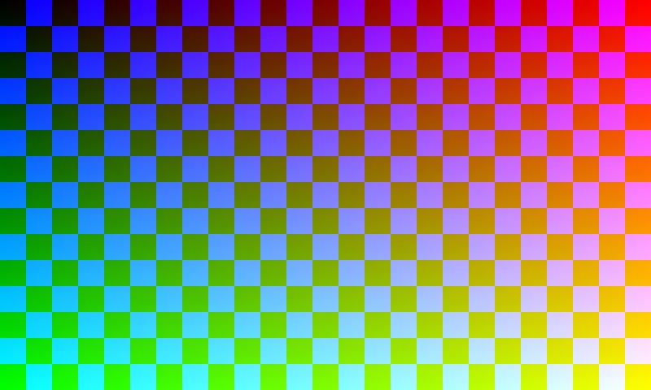

# JPEG 实现与 USB 吞吐验证

这是未接实体屏时的首轮历史记录。实屏发现的停启 VDMA 黑闪问题及当前修复见 [连续扫描修复](lcd-continuous-scanout.md)。

2026-11-06，Asia/Shanghai。RGB565 基线已先提交并打 tag `rgb565-baseline-20261106`；清理 reference 历史后，对应提交为 `09186d4`。
本轮全部为 JTAG/RAM 加载，未写 QSPI，LCD 仍未接。下列图像正确性是物理 DDR 校验，非屏幕拍照。

## 23MB/s 的原因及分层实测

原测试 `tools/acceptance.py` 采用 `(i+1)/30` 主动等待下一帧时间，产品串也设为 Fps30。
因此 800×480×2×30 = 23,040,000 B/s，23MB/s 只是按 30fps 发送全幅 RGB565 的数据量。
原结果不能用于判定 USB 总线极限。

先在原 tag 对应固件上去掉主机限速：128 帧，单帧/8 帧一批分别为 29.506 / 29.517 MB/s。
批量提交未带来明显提升。随后增加独立接收、像素处理、cache flush、VDMA 操作、指纹计算的计时。
以下为最终固件三轮结果：每轮 128 帧，总线方向 PC→Zynq（OUT），每帧 768000+16 B，8 帧合并提交。
每组计时结束都等待板端完成全部 128 帧，且检查坏帧、显示错误、超时没有增加。

| 路径 | 第1轮 MB/s | 第2轮 MB/s | 第3轮 MB/s | 中位 MB/s |
| --- | ---: | ---: | ---: | ---: |
| RGB565 + 转换 + VDMA 提交 + FNV | 29.409 | 29.415 | 29.426 | **29.415** |
| RGB565 + 转换 + VDMA 提交，不算 FNV | 41.662 | 41.795 | 41.740 | **41.740** |
| 只接收/校验帧边界，不复制像素/转换/提交 | 41.965 | 41.972 | 41.964 | **41.965** |

原始证据：`validation/jpeg-neon-20261106/throughput-final.json`；无节流基线见同目录 `throughput-baseline-batch*.json`。
MB/s 为十进制，总线计时包含帧头、主机提交和最后一帧完成等待。

单轮代表性分项：RGB565 转换约 8.39ms/帧、输入复制约 2.06ms/帧、flush 约 1.42ms/帧，
FNV 约 9.91ms/帧，VDMA 停止/地址切换/启动约数微秒。统计是 CPU 全局计时器测量，不是逻辑分析仪采样。
FNV 是验收指纹，不是 USB 必须的校验；已从正常显示路径移出，验证时通过 `0x33/flags=0` 显式开启。

根据这些耗时和 512KiB DMA 环容量，推断原复制/转换/FNV 串行处理会让环更容易填满并产生反压；
移除 FNV 后，完整 RGB 处理速率已接近纯接收速率。没有使用 USB 总线分析仪直接测量 NAK 次数。

ZynqLinkPRO 参考记录 `E:/zynqlinkPRO/docs/validation/j7-traceclk-20261106/README.md` 中，
100MiB 已完成 DDR 记录的下载中位为 38.750/38.689 MB/s，方向是 **Zynq→PC（IN）**。
该路径不做 RGB 转换、JPEG 解码和显示提交，本轮是 OUT，故它们并非完全相同的测试。
本轮已证明同一板子的 USB Display OUT 路径也能超过 30MB/s，并没有 23MB/s 的 USB 硬限制。

## JPEG 实现

- 线协议仍为 16 字节帧头；type=0 RGB565，type=3 JPEG，同一固件同时支持。
- 使用固定版本 libjpeg-turbo 3.1.2，ARMv7 hard-float、Neon SIMD；板端分派查询读回 neon=1。
- 直接输出 JCS_EXT_BGR 到未扫描的 DDR 缓冲，避免解码后再做全幅 RGB/BGR 搬运。
- 支持 8-bit baseline JPEG 的 4:2:0/4:2:2/4:4:4、灰度，以及 progressive JPEG。
- 帧头尺寸、JPEG 内部尺寸、ROI 边界、数据精度和分量数均检查；错误通过 setjmp/longjmp 收敛，释放解码器资源。
- 截断、错误码流和尺寸不符时保留上一幅已提交画面；下一幅合法 JPEG 可继续显示。
- 每路输入缓冲 4MiB，帧头可表达最大 4MiB−1；堆 8MiB，栈 64KiB。链接器断言程序/堆/栈不会越过 0x02000000 的帧缓冲。
- 生产路径不逐帧算 FNV；解码验证时显式开启。Bare-metal 单解码线程，禁用 OS TLS、文件工具、TurboJPEG API 及算术编码。

产品串 `zynq_R800x480_Ejpg8_Ergb16_Fps30_Bl4096`，首个 E 项决定驱动优先编码。
Windows 全局注册表 udisp 可覆盖产品串，因此 `tools/set_mode.py` 会同步设置并重启 MI_00，同时保持原主屏。
Bl 是 KiB 缓冲限制，非行数。RGB 与 JPEG 切换不需要重新刷固件。

本版未修改 PL、未新增 JPEG RTL：已有 Cortex-A9 Neon 足以完成本轮功能和常见测试图的 30fps。
这不等于所有图像均可达到 30fps；若增加高熵图像也必须持续 30fps 的要求，当前 CPU 路径仍需进一步加速，PL 解码是后续选项。

## JPEG 板测

最终配对验证涵盖 5 类整图和一个非对齐矩形，全部通过：

| 测试 | 物理 DDR 与主机参考解码 |
| --- | --- |
| 800×480，4:2:0，quality80 | 逐字节一致 |
| 800×480，4:2:2，quality95 | 逐字节一致 |
| 800×480，4:4:4，quality90 | 逐字节一致 |
| 800×480，progressive | 逐字节一致 |
| 800×480，grayscale | 逐字节一致 |
| 127×83 JPEG，坐标 (13,17) | 整幅图比较通过，区域外保留 |

还测试截断 JPEG、错误 entropy 数据、SOF 与帧头尺寸不一致、空 JPEG；均被拒绝，随后合法帧恢复。
原 RGB565 的 9 项回归也通过。预期错误会累加 bad/rx_timeouts，不能当作正常持续流故障。

渐变测试图 JPEG 为 17320 B：300 帧定速 30fps 实测约 **29.998fps**，不节流约 **72.72 次解码/提交每秒**，
平均解码约 **11.95ms**，加 flush/提交约 13.6ms。
这些是软件处理/提交能力；LCD 本身时序约 60Hz，且本次未接屏，不能将 72.72 当作面板刷新率。

另测高熵噪声图：800×480、4:2:0、quality80、JPEG 256977 B，128 帧不节流约 **26.24fps**，
平均解码约 **35.46ms**。此时 USB 只有 6.74MB/s，瓶颈是 CPU 解码而非总线。
该边界保留，不以更易压缩的图案结果覆盖它。

机器可读证据在 `validation/jpeg-neon-20261106/`：

- `jpeg-report.json`：完整像素比较、错误恢复、定速和不限速 JPEG 测试。
- `rgb-regression.json`：原 RGB565 行为回归及物理 DDR 比较。
- `throughput-jpeg-noise.json`：高熵图像性能边界。
- `idd-jpeg.json`、`idd-rgb565.json`：已安装 Windows 驱动实际通过 MI_00 发送两种类型，last_type 分别为 3 和 0。
- `display-enabled.json`：1920×1080 主屏保持主屏，USB 800×480 作为左侧扩展屏。
- `pair.json`、`tested-manifest.json`：实际加载的 bit/ELF/HDF/init 和源码/库哈希。



## 复测

```powershell
python tools/build.py
./tools/load.ps1
./tools/test.ps1
./tools/jpeg_test.ps1
./tools/benchmark.ps1
python tools/set_mode.py jpeg
```

测试和切换脚本会先暂停 MI_00，结束后以扩展模式恢复，避免原先“仅 USB 屏显示”关闭电脑主屏。
任意实体插拔次数的长期稳定性、实体 LCD 颜色/方向/撕裂/提交间隙仍不在本次验收范围。

## 问题状态

| 编号 | 状态 | 说明 |
| --- | --- | --- |
| UD-009 | 已澄清并实测 | 23MB/s 是 30fps 限速；旧正常路径另有 FNV 开销。关闭生产 FNV 后 RGB 提交中位 41.74MB/s。 |
| UD-006 | 功能已完成并板验 | JPEG 现已支持，正确性、错误恢复、实际 IDD 两模式切换通过；实体 LCD 出图待接屏。 |
| UD-010 | 已量化的性能边界 | 高熵噪声 JPEG 约 26.24fps；不保证任意图片 30fps，若要求更高需进一步硬件/软件加速。 |
| UD-004 | 原限制保留 | 本机全量 PL 综合的动态时钟 IP 异常未在本轮修复；本轮仍用已提供 LCD bit。 |

上游版本/许可证见 [第三方说明](../third_party/README.md)。
This software is based in part on the work of the Independent JPEG Group.
